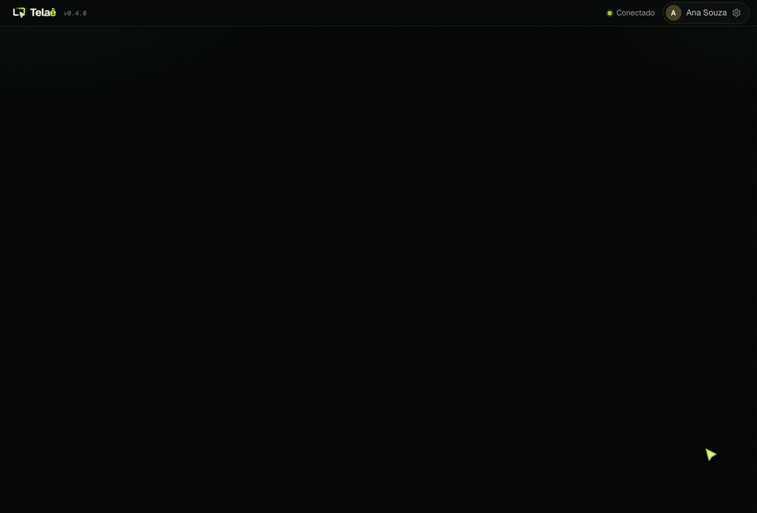
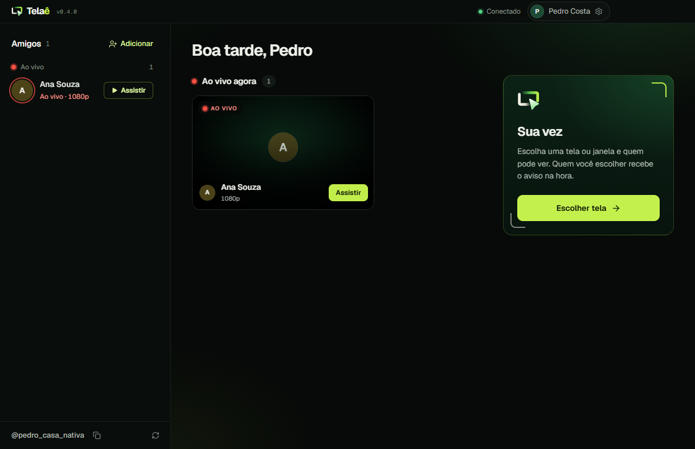
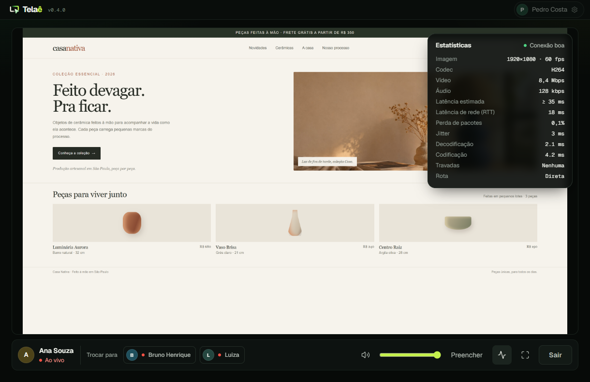
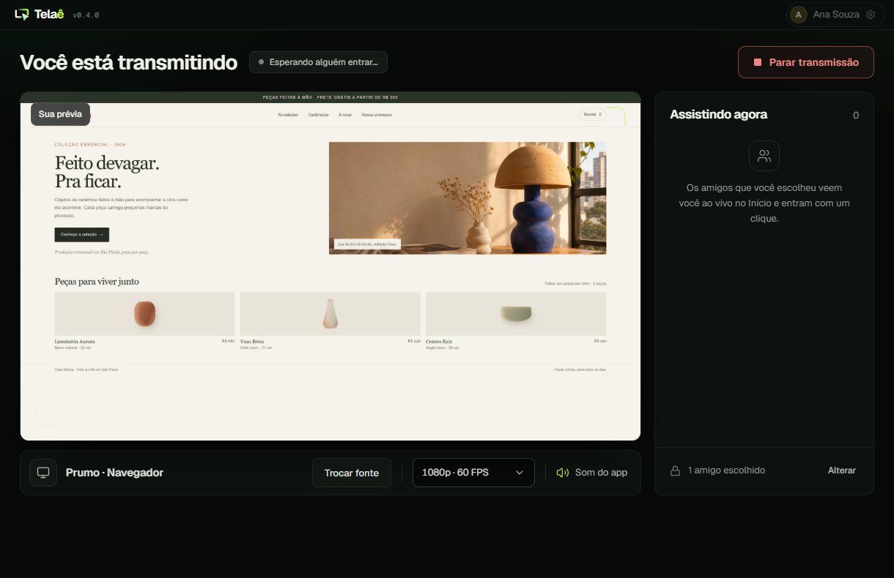
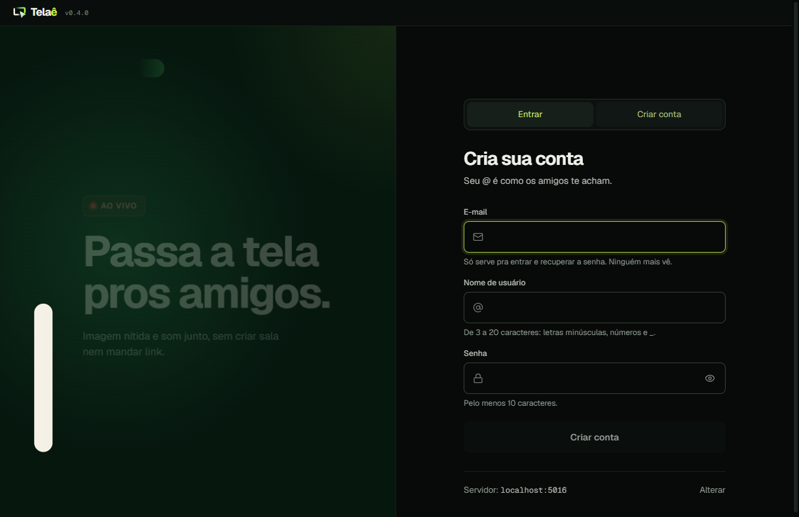
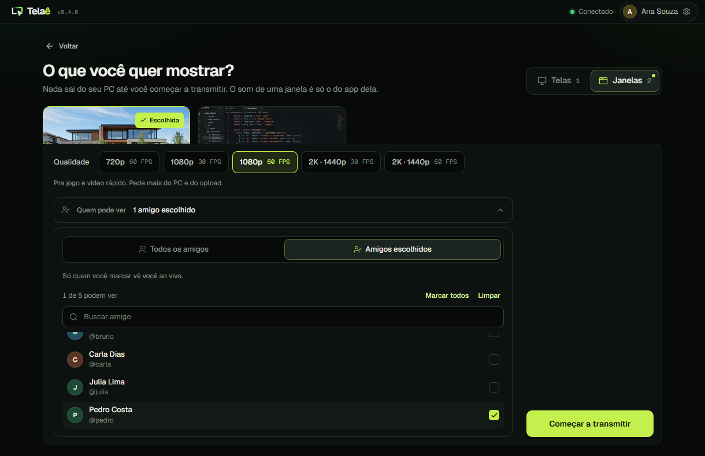
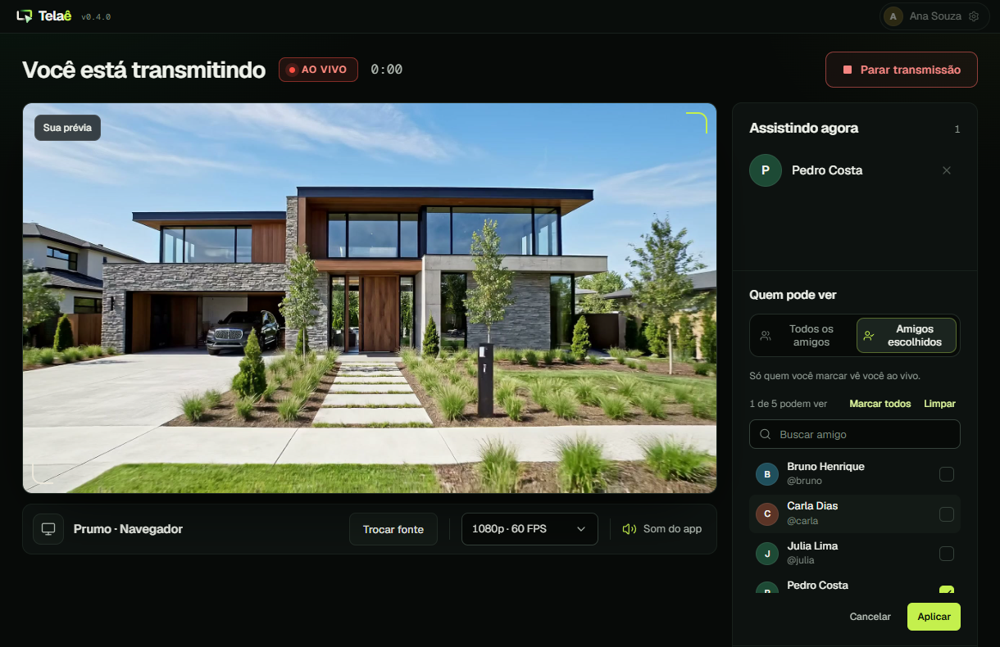
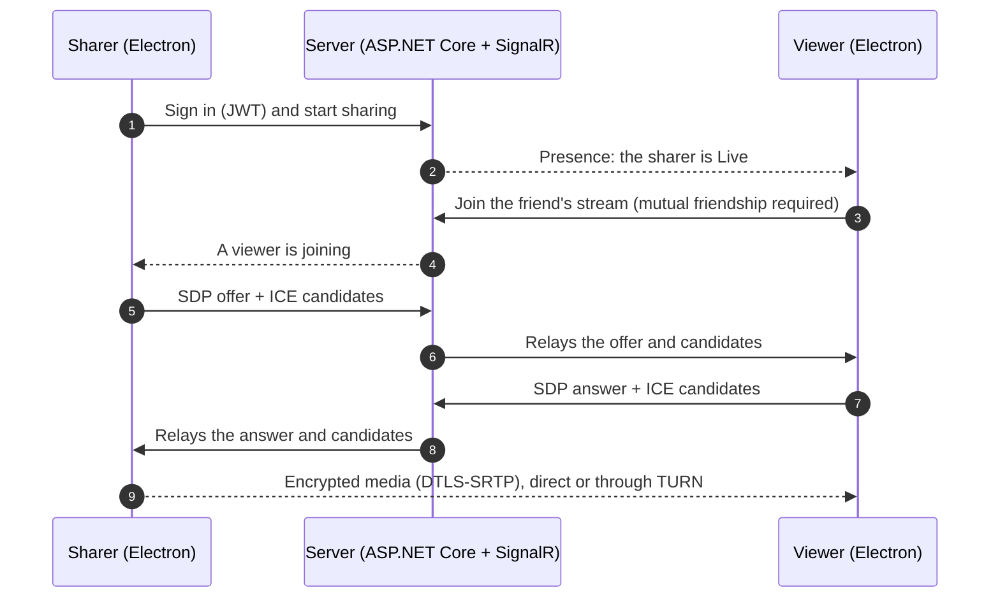

<div align="center">

[Português](README.md) · **English**


# Telaê

**Share your screen with friends in high quality and low latency.**

A Windows desktop app with video up to 1440p60, system or per-application audio and peer-to-peer WebRTC transport. No rooms, no links: friends who are live show up in your list and you join with one click.

[](https://github.com/NicolasPortie/Telae/actions/workflows/validate.yml)
[](https://github.com/NicolasPortie/Telae/releases)


[In use](#in-use) · [Features](#features) · [How it works](#how-it-works) · [Getting started](#getting-started) · [Self-hosting](#self-hosting) · [Documentation](#documentation)

</div>

## In use

<p align="center">
  
</p>

<p align="center"><sub>The Casa Nativa shop page appears on the Home screen of allowed friends and opens in the player when they join.</sub></p>

## Table of contents

- [Overview](#overview)
- [Features](#features)
- [Screenshots](#screenshots)
- [How it works](#how-it-works)
- [Tech stack](#tech-stack)
- [Repository layout](#repository-layout)
- [Getting started](#getting-started)
- [Self-hosting](#self-hosting)
- [Security](#security)
- [Known limitations](#known-limitations)
- [Documentation](#documentation)
- [Contributing](#contributing) · [License](#license) · [Author](#author)

## Overview

Telaê lets you share a screen or window with friends, with synced audio. Whoever is streaming shows up as **Live** in your friends list; click to watch. There are no rooms, calls or channels.

The app combines Windows audio capture, WebRTC transport, accounts, friends and automatic updates. Picture travels directly between computers; the server keeps accounts, friend lists and connections in sync.

## Features

- **Up to 1440p60** with explicit profiles (720p60, 1080p30, 1080p60, 1440p30, 1440p60) and automatic adaptation under CPU or network pressure.
- **Synced audio** from the whole system or only the chosen application, captured by a native bridge using Windows process loopback. Discord's audio is excluded automatically when sharing a full screen.
- **Friends and presence**: add people by their @username, mutual friendship, friend requests and quick switching between live streams. The friend list lives on the server, so it follows your account to any computer.
- **Live previews**: a stream thumbnail refreshes on the Home screen of friends allowed to watch. Choose all friends or selected friends; people left out see neither the live card nor its preview. The image stays in memory during the stream.
- **Who can watch**: when you stream, choose all friends or only some (and change it mid-stream), and hide your streams from anyone without unfriending them. People left out only see you as online.
- **Multiple viewers** per stream, each with an independent connection, quality and recovery.
- **Real-time statistics** in the player and on the sharer screen: resolution, FPS, bitrate, estimated latency, jitter, packet loss, freezes and route (direct or relayed).
- **Peer-to-peer first**: media flows directly between peers and uses TURN only when the network requires it.
- **Accounts**: email and password with 6-digit email verification, password recovery, rotating sessions and account deletion ([ADR 0004](docs/adr/0004-user-accounts.md)). Tokens are kept in the OS keystore.
- **Windows notifications** when a friend goes live, optional launch at startup and automatic updates in official builds, verified with the project's release key.
- **English and Portuguese** interface, with Brazilian Portuguese as the default and language selection in Settings.

## Screenshots

<table>
  <tr>
    <td width="50%"></td>
    <td width="50%"></td>
  </tr>
  <tr>
    <td align="center"><sub>Home: open a friend's live stream from the card</sub></td>
    <td align="center"><sub>Player: the shared page fills the app window</sub></td>
  </tr>
  <tr>
    <td width="50%"></td>
    <td width="50%"></td>
  </tr>
  <tr>
    <td align="center"><sub>The selected window appears in the sharing preview</sub></td>
    <td align="center"><sub>Set up an account so friends can add you</sub></td>
  </tr>
  <tr>
    <td width="50%"></td>
    <td width="50%"></td>
  </tr>
  <tr>
    <td align="center"><sub>Who can see: all friends, or only the ones you pick</sub></td>
    <td align="center"><sub>Change the audience while the stream is already live</sub></td>
  </tr>
</table>

## How it works



The server handles accounts, friendships, presence, signaling and authorized thumbnails. Stream video and audio travel over WebRTC, directly between computers or through a TURN relay. The sharer encodes the capture once per viewer, and a quality controller adjusts bitrate, resolution and frame rate from live statistics.

The full design is in [docs/ARCHITECTURE.md](docs/ARCHITECTURE.md) and the decision records in [docs/adr](docs/adr).

## Tech stack

| Area | Technology |
| --- | --- |
| Desktop shell | Electron 44, electron-vite, electron-builder (NSIS), electron-updater |
| Interface | React 19, TypeScript 6, Tailwind CSS 3, Geist and Geist Mono |
| Media | Chromium WebRTC (H.264, Opus), `RTCRtpSender` parameters, AudioWorklet PCM path |
| Native audio | .NET 10 and NAudio, Windows process loopback capture |
| Backend | ASP.NET Core 10, SignalR, Entity Framework Core, JWT |
| Data | PostgreSQL in production, SQLite in development |
| Delivery | GitHub Actions, Docker Compose, tag-based releases and auto-update feed |

## Repository layout

| Folder | Description |
| --- | --- |
| [`apps/desktop`](apps/desktop) | Electron app: capture, WebRTC, adaptive quality and UI. |
| [`apps/server`](apps/server) | Signaling service: accounts, friends, sessions and ephemeral TURN credentials. |
| [`apps/audio-bridge`](apps/audio-bridge) | Native audio bridge for per-application capture on Windows. |
| [`ops`](ops) | Scripts and units to deploy the Linux server and publish updates. |
| [`docs`](docs) | Architecture, stream privacy, decision records (ADR) and release notes. |

## Getting started

### Download

Grab the generic Windows installer (`Telae-Setup-<version>.exe`) from the [latest release](https://github.com/NicolasPortie/Telae/releases/latest). It has no default server or official update feed. The maintainer distributes the official installer through a separate stable download link: it includes the official server and automatically installs future updates after verifying the project's Ed25519 signature. The installers do not have Windows Authenticode certificates yet, so SmartScreen may warn on the initial installation.

To use the generic installer, [run your own server](#self-hosting) and set its address on the sign-in screen (**Server > Change**) or in Settings. To include a default address in your installer, set `TELAE_DEFAULT_SERVER_URL` when running `npm run dist`.

### Use with friends

1. Connect both apps to the same server and create your accounts.
2. Send a request using your friend's @username and wait for them to accept.
3. Click **Choose screen**, select a screen or window and choose who can watch.
4. Start streaming. Your friend can click **Watch** on Home or in the friends list.

During the stream, use **Who can watch > Change** to edit the audience. The preview updates to match your selection. Use the eye icon in the friends list to hide your streams from someone; undo it in **Privacy**.

### Build from source

**Requirements:** Windows 10/11 x64, Node.js 22+ and the .NET 10 SDK. Per-application audio filtering needs Windows build 20348 or later.

Signaling server (in development, uses local SQLite and saves verification emails in `apps/server/data/dev-mail`, so no external database or SMTP server is needed):

```bash
dotnet run --project apps/server/Telae.Server.csproj
```

Desktop app, in another terminal:

```bash
cd apps/desktop
npm ci
npm run dev
```

To build the Windows installer:

```bash
cd apps/desktop
npm run dist
```

## Self-hosting

The signaling server and its PostgreSQL database run in containers. Copy `.env.example` to `.env`, set `POSTGRES_PASSWORD` and `TELAE_JWT_KEY` (and the SMTP settings, so verification emails can be sent), then:

```bash
docker compose up -d
```

In the app, open **Settings > Signaling server** and enter its address (for example `http://localhost:5015`). The server keeps profiles in a volume and exposes `GET /health`.

Compose binds the port to the local computer only (`127.0.0.1:5015`). For friends on other computers, expose the service through an HTTPS proxy and use the same address in both apps. Set `TELAE_ALLOWED_EMAILS` to the participants' emails or open registration with `TELAE_REGISTRATION_OPEN=true`.

| Variable | Purpose |
| --- | --- |
| `POSTGRES_PASSWORD` | Password of the PostgreSQL database. |
| `TELAE_JWT_KEY` | Signing key for access tokens (32+ characters). |
| `SMTP_HOST`, `SMTP_PORT`, `SMTP_USER`, `SMTP_PASSWORD`, `SMTP_FROM` | Transactional email. Configure SMTP in production for verification and account recovery. Without it, email delivery is unavailable; in development, emails are saved in `data/dev-mail`. |
| `TELAE_ALLOWED_EMAILS` | Comma-separated emails that may create an account. Registration is **closed by default**: anyone else is refused. |
| `TELAE_REGISTRATION_OPEN` | Set to `true` to let anyone create an account (public servers). |
| `Auth__AllowLegacyDevices` | Accepts clients released before accounts (no sign-in). Off by default. |
| `Auth__StrictRequestsPerMinute`, `Auth__RequestsPerMinute` | Per-IP limits for sign-up and other account calls. |
| `Turn__Secret`, `Turn__Urls__0` | Optional TURN relay for restrictive networks. |

For restrictive networks, configure a TURN server (see [`ops/turnserver.conf.example`](ops/turnserver.conf.example) and the comments in [`docker-compose.yml`](docker-compose.yml)). Release, deploy and update operations are described in [docs/OPERATIONS.md](docs/OPERATIONS.md).

## Security

- The renderer is isolated (`contextIsolation`, no Node integration, sandbox, strict CSP) and talks to the main process through a narrow, typed preload API.
- Passwords are hashed with the ASP.NET Core password hasher. Sessions use short-lived JWT access tokens and rotating refresh tokens with reuse detection, stored encrypted with the OS keystore.
- Joining a stream requires mutual friendship and goes through a single access rule on the server (chosen audience, hidden and removed people). The server also enforces input limits and per-IP and per-connection rate limits.
- Media is encrypted end to end between peers (DTLS-SRTP); TURN credentials are ephemeral.

To report a vulnerability, see [SECURITY.md](SECURITY.md).

## Known limitations

- Windows only for now (the capture and audio pipeline depends on Windows APIs).
- The installers do not have Windows Authenticode certificates yet, so SmartScreen may warn on first run. Official automatic updates use a separate pinned Ed25519 release key; generic builds need their own trusted feed and release key.
- Each viewer receives its own encoded stream, so upload bandwidth and CPU grow with the number of viewers. An SFU is a future option.
- 1440p60 depends on the machine and the network.

## Documentation

- [Architecture](docs/ARCHITECTURE.md) and [project spec](docs/PROJECT_SPEC.md)
- [Stream privacy](docs/adr/0005-share-audience.md)
- [UI design](docs/DESIGN.md) and [glossary](GLOSSARY.md)
- [Operations: release, deploy and updates](docs/OPERATIONS.md)
- [Changelog](CHANGELOG.md)

## Contributing

To report a problem, open an issue. Read [CONTRIBUTING.md](CONTRIBUTING.md) before contributing and follow the [Code of Conduct](CODE_OF_CONDUCT.md).

## License

Released under the [MIT License](LICENSE).

## Author

Built by **Nicolas Portie** · [GitHub](https://github.com/NicolasPortie)
