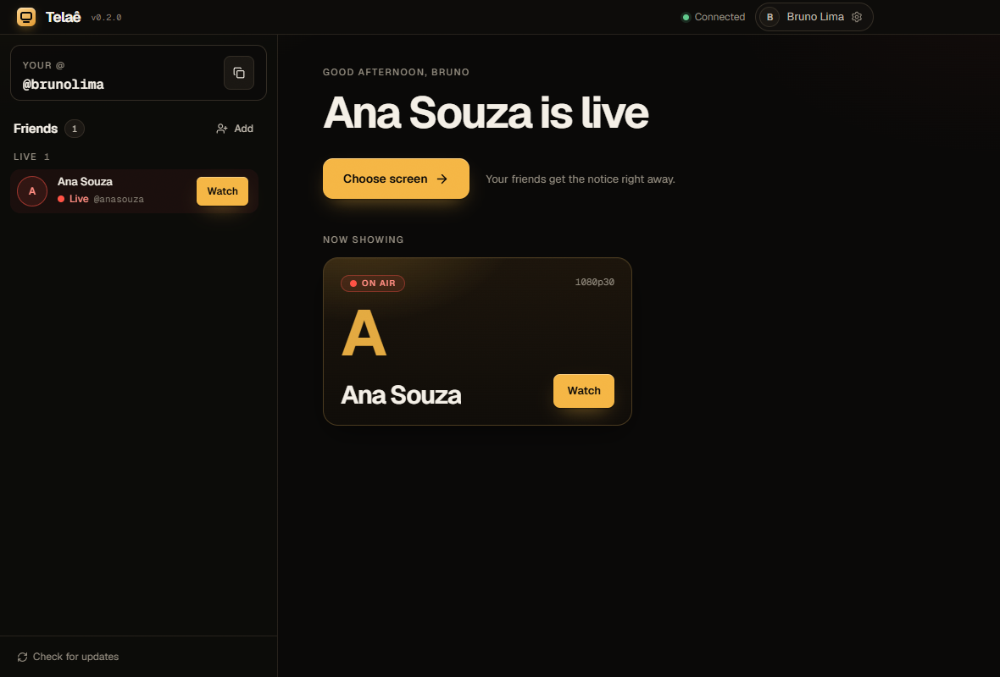
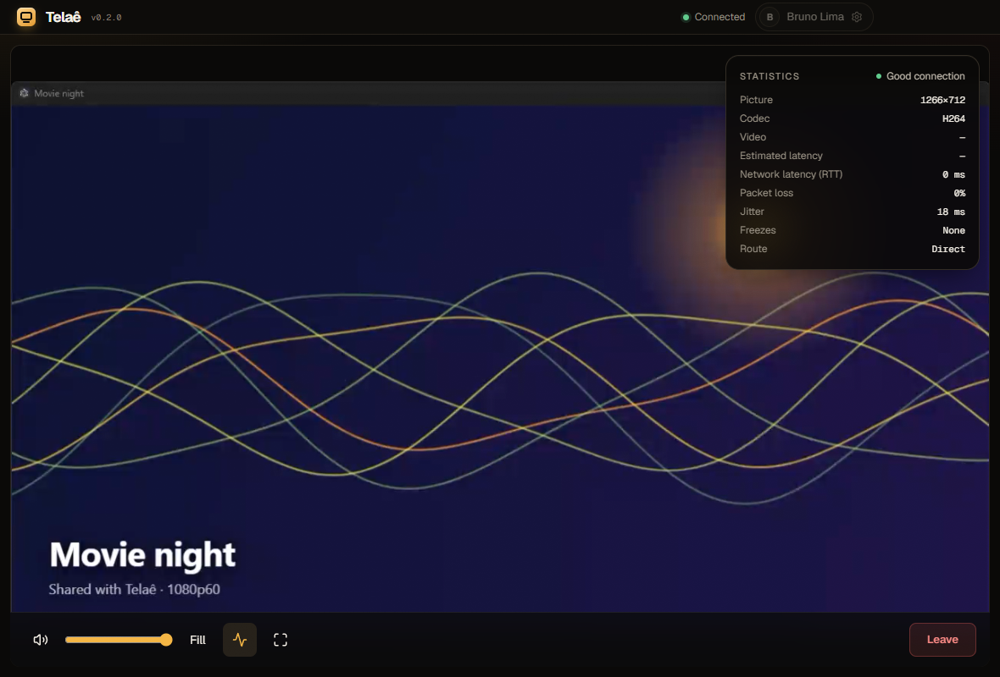
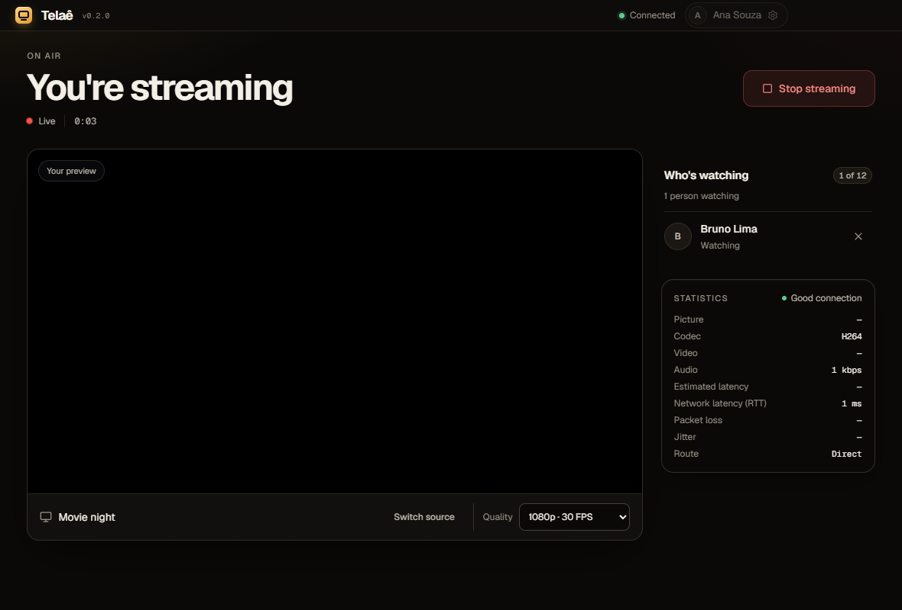
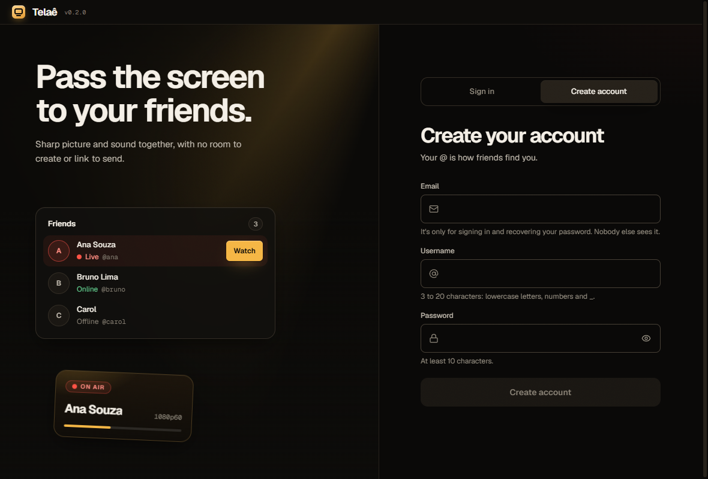
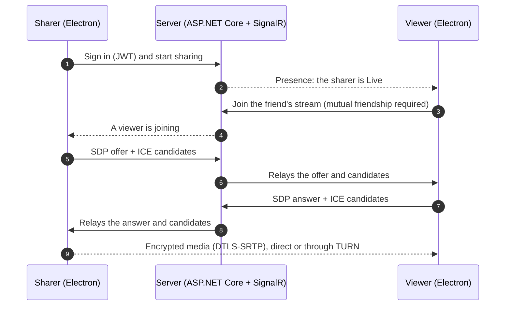

<div align="center">

**English** · [Português](README.pt-BR.md)


# Telaê

**Share your screen with friends in high quality and low latency.**

A Windows desktop app with video up to 1440p60, system or per-application audio and peer-to-peer WebRTC transport. No rooms, no links: friends who are live show up in your list and you join with one click.

[](https://github.com/NicolasPortie/Telae/actions/workflows/validate.yml)
[](https://github.com/NicolasPortie/Telae/releases)


[Demo](#demo) · [Features](#features) · [How it works](#how-it-works) · [Getting started](#getting-started) · [Self-hosting](#self-hosting) · [Documentation](#documentation)

</div>

## Demo

<p align="center">
  
</p>

<p align="center"><sub>Ana picks a window and goes live; Bruno sees her in his friends list, watches in one click and opens the live statistics (direct route, 1 ms RTT, no packet loss).</sub></p>

## Table of contents

- [Overview](#overview)
- [Features](#features)
- [Screenshots](#screenshots)
- [How it works](#how-it-works)
- [Tech stack](#tech-stack)
- [Repository layout](#repository-layout)
- [Getting started](#getting-started)
- [Self-hosting](#self-hosting)
- [Tests and quality](#tests-and-quality)
- [Security](#security)
- [Known limitations](#known-limitations)
- [Documentation](#documentation)
- [Contributing](#contributing) · [License](#license) · [Author](#author)

## Overview

Telaê does one thing well: pick a screen or window and let a friend watch it with a sharp picture, synced sound and low latency. There are no rooms, calls or channels. Whoever is streaming shows up as **Live** in your friends list, and you join with one click.

The goal of the project is a screen-sharing product that is genuinely good at its single job, built end to end: a native capture pipeline for audio, adaptive WebRTC transport, an account and friends backend, auto-updates and a measured quality process.

## Features

- **Up to 1440p60** with explicit profiles (720p60, 1080p30, 1080p60, 1440p30, 1440p60) and automatic adaptation under CPU or network pressure.
- **Synced audio** from the whole system or only the chosen application, captured by a native bridge using Windows process loopback. Discord's audio is excluded automatically when sharing a full screen.
- **Friends and presence**: add people by their @username, mutual friendship, friend requests and quick switching between live streams. The friend list lives on the server, so it follows your account to any computer.
- **Up to 12 viewers** per stream, each with an independent connection, quality and recovery.
- **Real-time statistics** in the player and on the sharer screen: resolution, FPS, bitrate, estimated latency, jitter, packet loss, freezes and route (direct or relayed).
- **Peer-to-peer first**: media flows directly between peers and uses TURN only when the network requires it.
- **Accounts**: email and password with 6-digit email verification, password recovery, rotating sessions and account deletion ([ADR 0004](docs/adr/0004-user-accounts.md)). Tokens are kept in the OS keystore.
- **Windows notifications** when a friend goes live, optional launch at startup and background auto-updates.
- **English and Portuguese** interface, following the Windows language or chosen in Settings.

## Screenshots

<table>
  <tr>
    <td width="50%"></td>
    <td width="50%"></td>
  </tr>
  <tr>
    <td align="center"><sub>Home: friends grouped by Live, Online and Offline</sub></td>
    <td align="center"><sub>Viewer: player with controls and statistics (key <code>I</code>)</sub></td>
  </tr>
  <tr>
    <td width="50%"></td>
    <td width="50%"></td>
  </tr>
  <tr>
    <td align="center"><sub>Sharer: preview, viewers and telemetry</sub></td>
    <td align="center"><sub>Create account: your @username is how friends find you</sub></td>
  </tr>
</table>

## How it works



The server only handles accounts, friendships, presence and signaling. Once the connection is negotiated, video and audio never pass through it. The sharer encodes the capture once per viewer with Chromium's WebRTC stack, and a quality controller adjusts bitrate, resolution and frame rate from live statistics.

The full design is in [docs/ARCHITECTURE.md](docs/ARCHITECTURE.md) and the decision records in [docs/adr](docs/adr).

## Tech stack

| Area | Technology |
| --- | --- |
| Desktop shell | Electron 44, electron-vite, electron-builder (NSIS), electron-updater |
| Interface | React 19, TypeScript 6, Tailwind CSS 3, Geist and Geist Mono |
| Media | Chromium WebRTC (H.264, Opus), `RTCRtpSender` parameters, AudioWorklet PCM path |
| Native audio | .NET 10 and NAudio, Windows process loopback capture |
| Backend | ASP.NET Core 10, SignalR, Entity Framework Core, JWT |
| Data | PostgreSQL in production, SQLite in development |
| Tests | Vitest and Testing Library, xUnit, Playwright (two Electron instances) |
| Delivery | GitHub Actions, Docker Compose, tag-based releases and auto-update feed |

## Repository layout

| Folder | Description |
| --- | --- |
| [`apps/desktop`](apps/desktop) | Electron app: capture, WebRTC, adaptive quality and UI. |
| [`apps/server`](apps/server) | Signaling service: accounts, friends, sessions and ephemeral TURN credentials. |
| [`apps/audio-bridge`](apps/audio-bridge) | Native audio bridge for per-application capture on Windows. |
| [`tests`](tests) | Server tests and a real-audio regression test. |
| [`ops`](ops) | Scripts and units to deploy the Linux server and publish updates. |
| [`docs`](docs) | Architecture, decision records (ADR), quality validations and release notes (mostly in Portuguese). |

## Getting started

### Download

Grab the Windows installer (`Telae-Setup-<version>.exe`) from the [latest release](https://github.com/NicolasPortie/Telae/releases/latest). The installers are not code-signed yet, so Windows SmartScreen may warn on the first run: choose **More info > Run anyway**. The app updates itself in the background.

An account is needed to sign in. The default server is private and only accepts invited emails, so to try Telaê yourself [run your own server](#self-hosting) and point the app to it in **Settings > Signaling server**.

### Build from source

**Requirements:** Windows 10/11 x64, Node.js 22+ and the .NET 10 SDK. Per-application audio filtering needs Windows build 20348 or later.

Signaling server (uses a local SQLite file and prints verification codes to the log, so no database or mail server is needed):

```bash
dotnet run --project apps/server/Telae.Server.csproj
```

Desktop app, in another terminal:

```bash
cd apps/desktop
npm ci
npm run dev
```

To build the Windows installer:

```bash
cd apps/desktop
npm run dist
```

## Self-hosting

The signaling server and its PostgreSQL database run in containers. Copy `.env.example` to `.env`, set `POSTGRES_PASSWORD` and `TELAE_JWT_KEY` (and the SMTP settings, so verification emails can be sent), then:

```bash
docker compose up -d
```

In the app, open **Settings > Signaling server** and enter its address (for example `http://localhost:5015`). The server keeps profiles in a volume and exposes `GET /health`.

| Variable | Purpose |
| --- | --- |
| `POSTGRES_PASSWORD` | Password of the PostgreSQL database. |
| `TELAE_JWT_KEY` | Signing key for access tokens (32+ characters). |
| `SMTP_HOST`, `SMTP_PORT`, `SMTP_USER`, `SMTP_PASSWORD`, `SMTP_FROM` | Transactional email. Without `SMTP_HOST`, codes are only written to the log. |
| `TELAE_ALLOWED_EMAILS` | Comma-separated emails that may create an account. Registration is **closed by default**: anyone else is refused. |
| `TELAE_REGISTRATION_OPEN` | Set to `true` to let anyone create an account (public servers). |
| `Auth__AllowLegacyDevices` | Accepts clients released before accounts (no sign-in). Off by default. |
| `Auth__StrictRequestsPerMinute`, `Auth__RequestsPerMinute` | Per-IP limits for sign-up and other account calls. |
| `Turn__Secret`, `Turn__Urls__0` | Optional TURN relay for restrictive networks. |

For restrictive networks, configure a TURN server (see [`ops/turnserver.conf.example`](ops/turnserver.conf.example) and the comments in [`docker-compose.yml`](docker-compose.yml)). Release, deploy and update operations are described in [docs/OPERATIONS.md](docs/OPERATIONS.md).

## Tests and quality

```bash
cd apps/desktop
npm run lint        # oxlint
npm run typecheck   # tsc
npm test            # 207 unit and component tests (vitest)
npm run test:e2e    # two Electron instances + local server (Playwright)
```

```bash
dotnet test tests/server/Telae.Server.Tests.csproj   # 127 server tests
```

The end-to-end suite with real screen and audio capture is opt-in (`TELAE_E2E_MEDIA=1`). Measured results, methodology and raw evidence live in [docs/validation](docs/validation), [docs/BENCHMARK.md](docs/BENCHMARK.md) and [docs/RELEASE_VALIDATION.md](docs/RELEASE_VALIDATION.md). Continuous integration runs lint, type checks, unit tests, the server tests and the deterministic E2E suite on every push.

## Security

- The renderer is isolated (`contextIsolation`, no Node integration, sandbox, strict CSP) and talks to the main process through a narrow, typed preload API.
- Passwords are hashed with the ASP.NET Core password hasher. Sessions use short-lived JWT access tokens and rotating refresh tokens with reuse detection, stored encrypted with the OS keystore.
- Joining a stream requires mutual friendship, and the server enforces input limits and per-IP and per-connection rate limits.
- Media is encrypted end to end between peers (DTLS-SRTP); TURN credentials are ephemeral.

To report a vulnerability, see [SECURITY.md](SECURITY.md).

## Known limitations

- Windows only for now (the capture and audio pipeline depends on Windows APIs).
- The installers are not code-signed yet, so Windows SmartScreen may warn on first run.
- Each viewer receives its own encoded stream, so upload bandwidth and CPU grow with the number of viewers. An SFU is a future option.
- 1440p60 depends on the machine and the network; the validation docs list what was and was not measured.

## Documentation

- [Architecture](docs/ARCHITECTURE.md) and [project spec](docs/PROJECT_SPEC.md)
- [UI design](docs/DESIGN.md) and [glossary](GLOSSARY.md)
- [Operations: release, deploy and updates](docs/OPERATIONS.md)
- [Streaming quality](docs/validation/STREAMING_QUALITY_2026-10-12.md) and [benchmark](docs/BENCHMARK.md)
- [Changelog](CHANGELOG.md)

## Contributing

Issues and pull requests are welcome. Read [CONTRIBUTING.md](CONTRIBUTING.md) first and follow the [Code of Conduct](CODE_OF_CONDUCT.md).

## License

Released under the [MIT License](LICENSE).

## Author

Built by **Nicolas Portie** · [GitHub](https://github.com/NicolasPortie)
