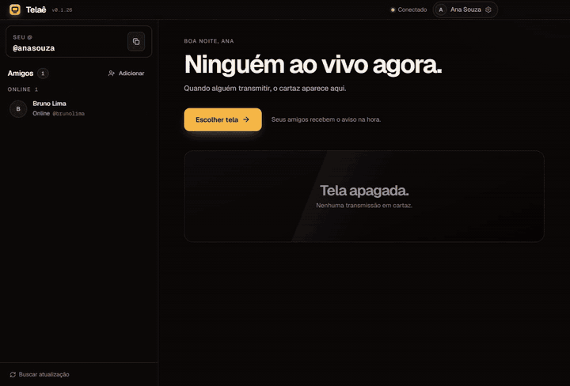
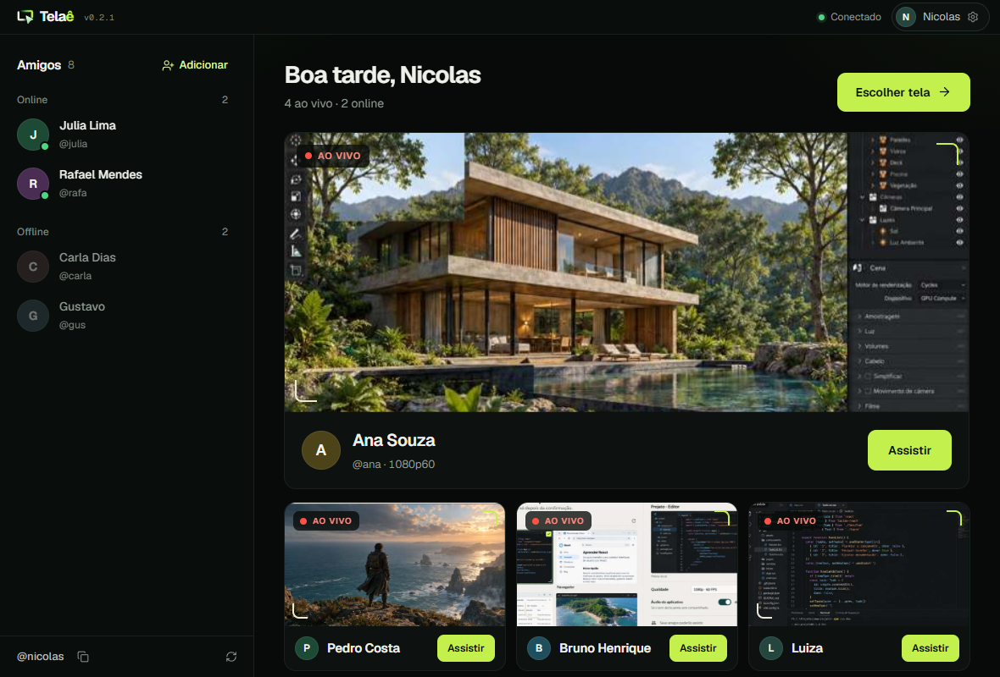
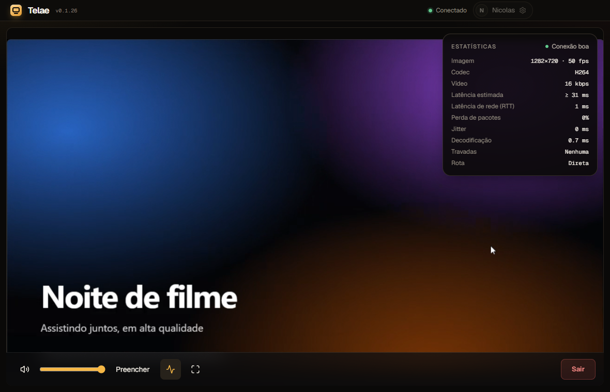
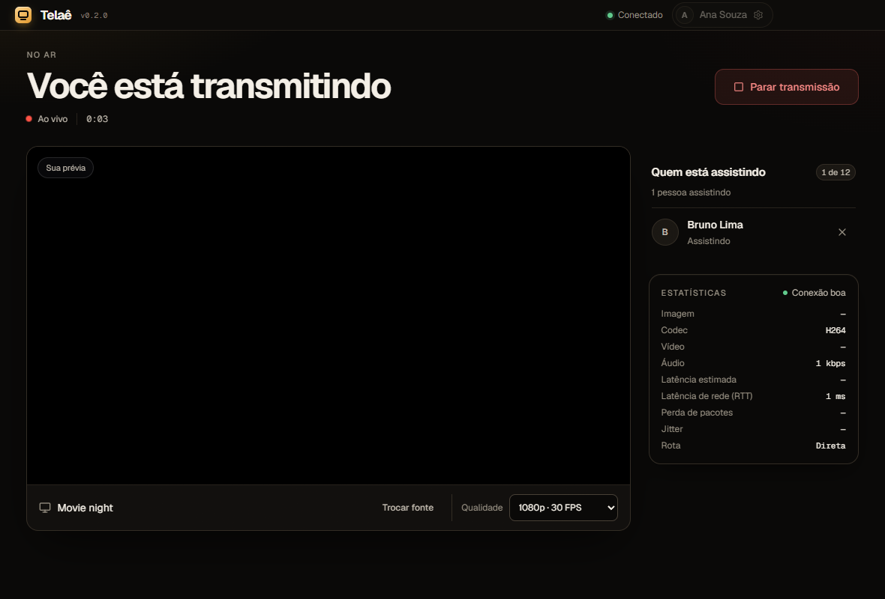
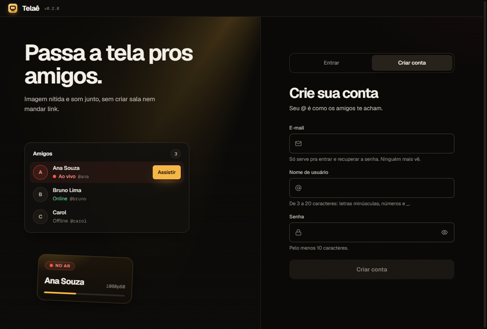
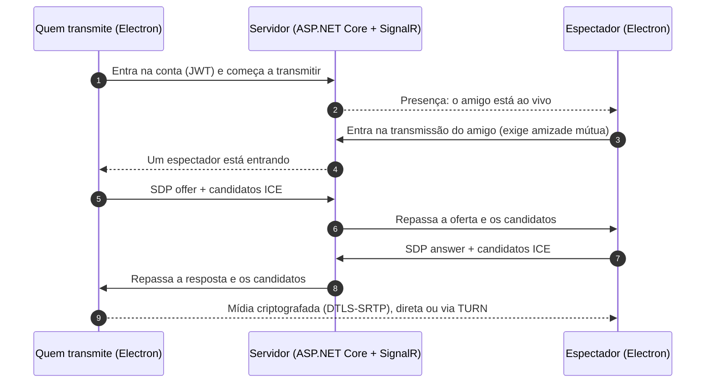

<div align="center">

[English](README.md) · **Português**


# Telaê

**Compartilhe sua tela com os amigos, com alta qualidade e baixa latência.**

Aplicativo de desktop para Windows com vídeo de até 1440p60, áudio do sistema ou de um aplicativo específico e transporte WebRTC ponto a ponto. Sem salas e sem links: quem está transmitindo aparece na sua lista de amigos e você entra com um clique.

[](https://github.com/NicolasPortie/Telae/actions/workflows/validate.yml)
[](https://github.com/NicolasPortie/Telae/releases)


[Demonstração](#demonstração) · [Recursos](#recursos) · [Como funciona](#como-funciona) · [Primeiros passos](#primeiros-passos) · [Hospedagem própria](#hospedagem-própria) · [Documentação](#documentação)

</div>

## Demonstração

<p align="center">
  
</p>

<p align="center"><sub>A Ana escolhe uma janela e entra ao vivo enquanto os amigos chegam. No PC do Pedro, a tela dela já está passando no Início; ele assiste com um clique e abre as estatísticas. Demonstração da interface com conteúdo de exemplo.</sub></p>

## Sumário

- [Visão geral](#visão-geral)
- [Recursos](#recursos)
- [Capturas de tela](#capturas-de-tela)
- [Como funciona](#como-funciona)
- [Tecnologias](#tecnologias)
- [Estrutura do repositório](#estrutura-do-repositório)
- [Primeiros passos](#primeiros-passos)
- [Hospedagem própria](#hospedagem-própria)
- [Testes e qualidade](#testes-e-qualidade)
- [Segurança](#segurança)
- [Limitações conhecidas](#limitações-conhecidas)
- [Documentação](#documentação)
- [Contribuindo](#contribuindo) · [Licença](#licença) · [Autor](#autor)

## Visão geral

O Telaê faz uma coisa bem feita: escolher uma tela ou janela e deixar um amigo assistir com imagem nítida, som sincronizado e baixa latência. Não há salas, chamadas nem canais. Quem está transmitindo aparece como **Ao vivo** na sua lista de amigos, e você entra com um clique.

O objetivo do projeto é um produto de compartilhamento de tela realmente bom na sua única tarefa, construído de ponta a ponta: captura de áudio nativa, transporte WebRTC adaptativo, backend de contas e amigos, atualização automática e um processo de qualidade com medições.

## Recursos

- **Até 1440p60**, com perfis explícitos (720p60, 1080p30, 1080p60, 1440p30, 1440p60) e adaptação automática sob pressão de CPU ou de rede.
- **Áudio sincronizado** do sistema inteiro ou só do aplicativo escolhido, capturado por uma ponte nativa com process loopback do Windows. O áudio do Discord é excluído automaticamente ao compartilhar a tela inteira.
- **Amigos e presença**: adicione pessoas pelo @usuário, amizade mútua, pedidos de amizade e troca rápida entre transmissões ao vivo. A lista fica no servidor e acompanha sua conta em qualquer computador.
- **Prévia ao vivo**: enquanto um amigo transmite, uma miniatura da tela dele se atualiza no seu Início a cada poucos segundos. Só amigos mútuos recebem, e nada é guardado.
- **Até 12 espectadores** por transmissão, cada um com conexão, qualidade e recuperação independentes.
- **Estatísticas em tempo real** no player e na tela de quem transmite: resolução, FPS, bitrate, latência estimada, jitter, perda de pacotes, travamentos e rota (direta ou via relay).
- **Ponto a ponto primeiro**: a mídia vai direto entre os pares e só usa TURN quando a rede exige.
- **Contas**: e-mail e senha com verificação por código de 6 dígitos, recuperação de senha, sessões com rotação e exclusão de conta ([ADR 0004](docs/adr/0004-user-accounts.md)). Os tokens ficam no cofre do sistema.
- **Avisos do Windows** quando um amigo entra ao vivo, início opcional com o Windows e atualização automática no instalador oficial, verificada pela chave de release do projeto.
- **Interface em português e inglês**, seguindo o idioma do Windows ou escolhida em Configurações.

## Capturas de tela

<table>
  <tr>
    <td width="50%"></td>
    <td width="50%"></td>
  </tr>
  <tr>
    <td align="center"><sub>Início: quem está ao vivo aparece com a tela passando</sub></td>
    <td align="center"><sub>Espectador: player com controles e estatísticas (tecla <code>I</code>)</sub></td>
  </tr>
  <tr>
    <td width="50%"></td>
    <td width="50%"></td>
  </tr>
  <tr>
    <td align="center"><sub>Transmissão: prévia, quem está assistindo e saúde da conexão</sub></td>
    <td align="center"><sub>Criar conta: o @usuário é como os amigos te encontram</sub></td>
  </tr>
</table>

## Como funciona



O servidor cuida só de contas, amizades, presença e sinalização. Depois que a conexão é negociada, vídeo e áudio não passam por ele. Quem transmite codifica a captura uma vez por espectador com a pilha WebRTC do Chromium, e um controlador de qualidade ajusta bitrate, resolução e taxa de quadros a partir das estatísticas ao vivo.

O desenho completo está em [docs/ARCHITECTURE.md](docs/ARCHITECTURE.md) (em inglês) e os registros de decisão em [docs/adr](docs/adr).

## Tecnologias

| Área | Tecnologia |
| --- | --- |
| Casca desktop | Electron 44, electron-vite, electron-builder (NSIS), electron-updater |
| Interface | React 19, TypeScript 6, Tailwind CSS 3, Geist e Geist Mono |
| Mídia | WebRTC do Chromium (H.264, Opus), parâmetros do `RTCRtpSender`, caminho PCM com AudioWorklet |
| Áudio nativo | .NET 10 e NAudio, captura por process loopback do Windows |
| Backend | ASP.NET Core 10, SignalR, Entity Framework Core, JWT |
| Dados | PostgreSQL em produção, SQLite em desenvolvimento |
| Testes | Vitest e Testing Library, xUnit, Playwright (duas instâncias do Electron) |
| Entrega | GitHub Actions, Docker Compose, releases por tag e canal de atualização automática |

## Estrutura do repositório

| Pasta | Descrição |
| --- | --- |
| [`apps/desktop`](apps/desktop) | App Electron: captura, WebRTC, qualidade adaptativa e interface. |
| [`apps/server`](apps/server) | Serviço de sinalização: contas, amigos, sessões e credenciais TURN efêmeras. |
| [`apps/audio-bridge`](apps/audio-bridge) | Ponte de áudio nativa para captura por aplicativo no Windows. |
| [`tests`](tests) | Testes do servidor e um teste de regressão com áudio real. |
| [`ops`](ops) | Scripts e units para publicar o servidor Linux e as atualizações. |
| [`docs`](docs) | Arquitetura, registros de decisão (ADR), validações de qualidade e notas de versão (em geral em português). |

## Primeiros passos

### Baixar

Baixe o instalador genérico do Windows (`Telae-Setup-<versão>.exe`) na [última release](https://github.com/NicolasPortie/Telae/releases/latest). Ele não vem com servidor nem feed oficial. O mantenedor distribui o instalador oficial por um link estável separado: ele já vem com o servidor e instala futuras atualizações automaticamente, após verificar a assinatura Ed25519 do projeto. Os instaladores ainda não têm certificado Authenticode do Windows, então o SmartScreen pode avisar na instalação inicial.

Os instaladores publicados aqui são genéricos: não vêm com servidor nenhum. O Telaê é código aberto, então, para usar com os seus amigos, [hospede o seu servidor](#hospedagem-própria) e informe o endereço na tela de entrada (**Servidor > Alterar**) ou em **Configurações > Servidor de sinalização**. Para embutir um padrão no seu próprio instalador, defina `TELAE_DEFAULT_SERVER_URL` ao rodar `npm run dist`.

### Compilar a partir do código

**Requisitos:** Windows 10/11 x64, Node.js 22+ e .NET 10 SDK. O filtro de áudio por aplicativo exige o Windows build 20348 ou superior.

Servidor de sinalização (usa um arquivo SQLite local e escreve os códigos de verificação no log, então não precisa de banco nem de servidor de e-mail):

```bash
dotnet run --project apps/server/Telae.Server.csproj
```

App desktop, em outro terminal:

```bash
cd apps/desktop
npm ci
npm run dev
```

Para gerar o instalador do Windows:

```bash
cd apps/desktop
npm run dist
```

## Hospedagem própria

O servidor de sinalização e o PostgreSQL rodam em contêineres. Copie `.env.example` para `.env`, defina `POSTGRES_PASSWORD` e `TELAE_JWT_KEY` (e o SMTP, para enviar os e-mails de verificação) e execute:

```bash
docker compose up -d
```

No app, abra **Configurações > Servidor de sinalização** e informe o endereço (por exemplo `http://localhost:5015`). O servidor guarda os perfis em um volume e expõe `GET /health`.

| Variável | Para que serve |
| --- | --- |
| `POSTGRES_PASSWORD` | Senha do banco PostgreSQL. |
| `TELAE_JWT_KEY` | Chave de assinatura dos tokens de acesso (32+ caracteres). |
| `SMTP_HOST`, `SMTP_PORT`, `SMTP_USER`, `SMTP_PASSWORD`, `SMTP_FROM` | E-mail transacional. Sem `SMTP_HOST`, os códigos vão só para o log. |
| `TELAE_ALLOWED_EMAILS` | E-mails (separados por vírgula) que podem criar conta. O cadastro vem **fechado por padrão**: qualquer outra pessoa é recusada. |
| `TELAE_REGISTRATION_OPEN` | Use `true` para deixar qualquer pessoa criar conta (servidores públicos). |
| `Auth__AllowLegacyDevices` | Aceita clientes lançados antes das contas (sem login). Desligado por padrão. |
| `Auth__StrictRequestsPerMinute`, `Auth__RequestsPerMinute` | Limites por IP do cadastro e das demais chamadas de conta. |
| `Turn__Secret`, `Turn__Urls__0` | Relay TURN opcional para redes restritivas. |

Para redes restritivas, configure um servidor TURN (veja [`ops/turnserver.conf.example`](ops/turnserver.conf.example) e os comentários do [`docker-compose.yml`](docker-compose.yml)). Release, deploy e atualizações estão descritos em [docs/OPERATIONS.md](docs/OPERATIONS.md).

## Testes e qualidade

```bash
cd apps/desktop
npm run lint        # oxlint
npm run typecheck   # tsc
npm test            # 207 testes unitários e de componentes (vitest)
npm run test:e2e    # duas instâncias do Electron + servidor local (Playwright)
```

```bash
dotnet test tests/server/Telae.Server.Tests.csproj   # 127 testes do servidor
```

O E2E com captura real de tela e áudio é opcional (`TELAE_E2E_MEDIA=1`). Resultados medidos, metodologia e evidências brutas estão em [docs/validation](docs/validation), [docs/BENCHMARK.md](docs/BENCHMARK.md) e [docs/RELEASE_VALIDATION.md](docs/RELEASE_VALIDATION.md). A integração contínua roda lint, tipos, testes unitários, testes do servidor e o E2E determinístico a cada push.

## Segurança

- O renderer é isolado (`contextIsolation`, sem Node, sandbox, CSP restrita) e conversa com o processo principal por uma API de preload estreita e tipada.
- As senhas usam o hasher de senhas do ASP.NET Core. As sessões usam tokens de acesso JWT de vida curta e tokens de renovação com rotação e detecção de reutilização, guardados cifrados no cofre do sistema.
- Entrar em uma transmissão exige amizade mútua, e o servidor impõe limites de entrada e de taxa por IP e por conexão.
- A mídia é criptografada entre os pares (DTLS-SRTP); as credenciais TURN são efêmeras.

Para relatar uma vulnerabilidade, veja [SECURITY.md](SECURITY.md).

## Limitações conhecidas

- Só Windows por enquanto (a captura e o áudio dependem de APIs do Windows).
- Os instaladores ainda não têm certificado Authenticode do Windows, então o SmartScreen pode avisar na primeira execução. A atualização automática oficial usa uma chave Ed25519 própria fixada no app; builds genéricos precisam configurar o próprio feed e chave de confiança.
- Cada espectador recebe um fluxo codificado só para ele, então upload e CPU crescem com o número de espectadores. Um SFU é uma opção futura.
- 1440p60 depende da máquina e da rede; os documentos de validação listam o que foi e o que não foi medido.

## Documentação

- [Arquitetura](docs/ARCHITECTURE.md) e [especificação do projeto](docs/PROJECT_SPEC.md) (em inglês)
- [Design da interface](docs/DESIGN.md) e [glossário](GLOSSARY.md)
- [Operação: release, deploy e atualizações](docs/OPERATIONS.md)
- [Qualidade de transmissão](docs/validation/STREAMING_QUALITY_2026-10-12.md) e [benchmark](docs/BENCHMARK.md)
- [Changelog](CHANGELOG.md)

## Contribuindo

Issues e pull requests são bem-vindos. Leia o [CONTRIBUTING.md](CONTRIBUTING.md) antes e siga o [Código de Conduta](CODE_OF_CONDUCT.md).

## Licença

Distribuído sob a [Licença MIT](LICENSE).

## Autor

Feito por **Nicolas Portie** · [GitHub](https://github.com/NicolasPortie)
