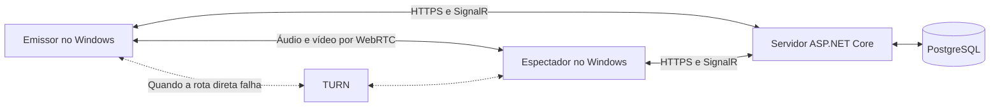

# Arquitetura do Telaê

## Componentes

O servidor coordena contas, amizades, presença e negociação de SDP e ICE. O fluxo de áudio e vídeo não passa por esse serviço. As prévias de tela são uma exceção: pequenos JPEGs passam pelo servidor e ficam apenas na memória da sessão.

O Electron separa o aplicativo em três partes:

- **Processo principal:** janela, permissões, armazenamento local, autenticação, atualizações e ponte nativa de áudio.
- **Preload:** expõe a API tipada `window.telae`, sem abrir o Node para a interface.
- **Interface:** componentes React e serviços de captura, sinalização, transporte, qualidade e reprodução.

O Chromium já fornece RTP/RTCP, DTLS-SRTP, ICE, negociação de codecs, controle de congestionamento e estatísticas. O ASP.NET Core e o SignalR cuidam da coordenação, sem precisar processar quadros de vídeo. Uma implementação própria de captura ou codificação só deve substituir essa parte quando houver medição que justifique o custo.

## Captura e transporte

`StreamController` controla a captura da fonte escolhida e a liberação das faixas de mídia. A interface usa operações pequenas, como iniciar, parar e observar o estado; não precisa gerenciar diretamente cada faixa do `MediaStream`.

Os serviços de sessão e transporte coordenam `RTCPeerConnection`, negociação SDP, candidatos ICE, envio das faixas, encerramento e recuperação. O serviço de sinalização mantém a conexão SignalR e traduz os eventos recebidos. Ele não é responsável pelo áudio ou vídeo.

O controle de qualidade combina o perfil escolhido com as estatísticas do codificador e da rede. Ajusta taxa de envio, resolução e frequência de quadros sem obrigar a interface a conhecer a negociação do WebRTC. A adaptação usa `RTCRtpSender.setParameters()` quando possível, evitando recriar a conexão a cada mudança.

A captura atual usa Electron/Chromium. A ponte nativa de áudio usa o loopback do Windows, inclusive por processo para janelas. Opus é usado no transporte do áudio. Processamento voltado à voz, como supressão de ruído, não deve modificar o áudio do sistema sem necessidade.

Quando uma captura termina ou o app encerra, as faixas e conexões locais são liberadas. Uma inicialização pendente pode ser cancelada. Mensagens da ponte de áudio e sua limpeza são vinculadas ao identificador da captura, mesmo quando duas janelas pertencem ao mesmo processo.

## Estados da transmissão

O estado apresentado na interface vem dos eventos de captura, sinalização, conexão e reprodução. Uma conexão de rede estabelecida não significa que a imagem já está aparecendo.

O espectador só é considerado ao vivo depois de o elemento de vídeo confirmar um quadro apresentado. Uma conexão sem imagem continua sujeita ao prazo de recuperação. Quando esse prazo acaba, a sessão é encerrada com o motivo correspondente.

## Conexão e vários espectadores

ICE usa STUN para encontrar caminhos diretos. Quando isso não funciona, TURN retransmite o tráfego WebRTC já criptografado. O espectador não precisa abrir portas de entrada no roteador. Configurar credenciais TURN não comprova que o caminho de retransmissão está acessível; essa validação exige uma conexão real com a política de ICE forçada para `relay`.

Cada transmissão aceita até 12 espectadores. Cada um tem sua própria conexão WebRTC, adaptação de qualidade e recuperação: até três reinícios de ICE, com prazo de dez segundos por tentativa. A falha de um espectador não encerra as conexões saudáveis.

A captura é única, mas a mídia é enviada separadamente a cada espectador. O consumo de envio e de codificação cresce com a quantidade de pessoas. O limite de 12 é uma regra de entrada, não uma garantia de 1080p60 em qualquer computador. Uma SFU continua como alternativa futura.

O teto total de envio de vídeo é de 40 Mbps por padrão, configurável entre 2 e 200 Mbps. Cada conexão recebe uma parte desse orçamento; áudio, cabeçalhos e transições de negociação geram tráfego adicional. Conteúdo de texto prioriza resolução; conteúdo em movimento prioriza quadros por segundo e pode reduzir a resolução. Pressão de CPU também participa da adaptação.

É possível trocar a qualidade e silenciar o áudio sem recriar a sessão. Remover um espectador revoga seu acesso pelo restante daquela transmissão. Ao trocar de amigo, uma recusa do servidor preserva a sessão atual.

## Contas e amigos

A identidade atual é uma conta no PostgreSQL, conforme a [ADR 0004](adr/0004-user-accounts.md). O app entra por REST, em `/auth/*`. O processo principal mantém o token de renovação, protegido pelo cofre do sistema, e entrega ao processo de interface um JWT curto para autenticar a conexão SignalR.

`RegisterDevice` usa a identidade do token validado, não uma identidade arbitrária enviada pelo cliente. O identificador do dispositivo corresponde à conta; o identificador público dos amigos é o `@usuário`.

Os tokens carregam o identificador da família de sessão. A autenticação REST e cada chamada ao hub verificam se ela continua ativa. Troca ou recuperação de senha e exclusão de conta revogam as famílias existentes e desconectam o dispositivo. Sair revoga somente a família daquela sessão, incluindo tokens já rotacionados.

Sessões locais são vinculadas à origem do servidor. Trocar a configuração não envia uma credencial de renovação para outro servidor: a nova origem exige autenticação. O administrador do servidor escolhido recebe os dados usados para entrar nele; HTTPS protege o transporte, mas não torna esse administrador confiável.

As amizades ficam no banco. Cada linha de `Friendships` representa quem adicionou quem; `DismissedRequests` registra pedidos dispensados. `GetFriends` usa a conta da conexão, carrega a lista e atualiza as assinaturas de presença e a visão de amizades mútuas usada na autorização. `AddFriend` e `RemoveFriend` atualizam o banco e sincronizam essa visão. Sessões que deixam de ter amizade mútua são encerradas.

Os pedidos pendentes são calculados a partir dessas relações, por isso sobrevivem a reinícios e chegam a quem estava desconectado. Consultar um identificador público ou enviar um pedido unilateral não revela presença ou qualidade ativa e não autoriza assistir.

O cadastro depende de `Auth__RegistrationOpen` e `Auth__AllowedEmails`. Com o cadastro fechado, somente e-mails liberados podem criar conta; os demais recebem `registration_closed` antes de criar conta ou enviar e-mail. `Auth__AllowLegacyDevices` mantém clientes sem conta desativados por padrão.

## Prévias e presença

Durante uma transmissão, o app envia um JPEG a cada oito segundos por `PublishSharePreview`. A imagem tem 640 pixels de largura e no máximo 96 KiB, incluindo a URL de dados. O servidor verifica a estrutura JPEG e os limites de dimensões: 4096 pixels por eixo e 4.194.304 pixels no total.

O servidor aceita no máximo uma prévia por dispositivo a cada seis segundos, inclusive após reconexão ou reinício da transmissão. Guarda somente o quadro mais recente na memória e o envia por `SharePreview` aos amigos mútuos conectados que não foram removidos da sessão. `GetFriendPreviews` aplica a mesma autorização. Os quadros não são persistidos e desaparecem ao encerrar a transmissão.

Mudanças de amizade, remoção de espectadores e envio de prévias são serializados para impedir que uma pessoa removida continue recebendo quadros novos. A presença também exige assinatura por `GetFriends` e amizade mútua. Uma nova solicitação substitui o conjunto anterior de assinaturas; uma lista vazia remove as assinaturas, e a reconexão precisa restaurá-las.

## Diagnóstico e limites

As estatísticas incluem taxa de envio, RTT, jitter, perdas, quadros, codec e par de candidatos selecionado. O diagnóstico diferencia uma faixa de áudio disponível do recebimento de pacotes; silêncio não é, sozinho, uma falha de transmissão.

O worklet de áudio por processo mantém até 120 ms de PCM em um buffer circular limitado e informa descartes e falta de amostras. Exportações de diagnóstico usam uma lista explícita de campos, sem códigos de convite, identidades ou identificadores de sessão. Mantêm até uma hora de amostras estruturadas e um histórico limitado de estados e categorias de erro.

RTT e `getStats()` não medem o atraso completo entre as duas telas nem o desvio perceptível entre áudio e vídeo. Essas medições dependem do [teste físico](BENCHMARK.md).

O servidor limita o tamanho das entradas e separa os orçamentos de registro, comandos e sinalização ICE. O registro comporta até 10.000 perfis e até 32 convites legados pendentes por emissor. Os limites de resolução, envio, áudio e adaptação da mídia são aplicados nos computadores: o serviço de sinalização não inspeciona nem controla o fluxo criptografado entre os pares.

## Segurança do aplicativo e das atualizações

O processo de interface usa `contextIsolation: true`, `nodeIntegration: false`, sandbox e CSP restritiva. IPC fica limitado ao documento principal confiável e valida os argumentos. A captura depende de uma fonte escolhida explicitamente; permissões físicas de câmera e microfone são negadas.

O servidor HTTPS de atualizações é fixado na compilação, separado do endereço editável de sinalização. Desde a 0.3.2, o instalador oficial também contém a chave pública Ed25519 de release. A assinatura cobre versão, nome, tamanho e SHA-512 do instalador. O app verifica o arquivo após baixar, inclusive se veio do cache, e repete a verificação antes de executar.

A chave privada fica fora do app e do servidor de downloads. Nesse fluxo, a instalação ao sair da biblioteca permanece desligada: somente o caminho que concluiu a verificação pode instalar. Transmissões ativas adiam o reinício. Authenticode é uma proteção adicional, não um requisito do canal Ed25519. Consulte [OPERATIONS.md](OPERATIONS.md) e [RELEASE_VALIDATION.md](RELEASE_VALIDATION.md).

## Compatibilidade com clientes antigos

O caminho anterior às contas permanece atrás de `Auth__AllowLegacyDevices`. Ele usa uma credencial aleatória de 256 bits; o servidor guarda somente seu SHA-256 e compara em tempo constante. Identificadores de dispositivo e códigos públicos não concedem autorização.

Nesse caminho, `JoinFriendShare` exige declaração mútua por `GetFriends`; pedidos podem ser aceitos ou dispensados por `DismissFriendRequest`. Perder a amizade remove um espectador ativo e notifica os participantes. `CreateInvite` e `JoinWithInvite` existem apenas por compatibilidade; o app atual não cria nem mostra esses convites. `JoinShare` direto continua limitado a quem já estava autorizado na sessão, e sair revoga essa autorização.

Perfis locais antigos sem credencial recebem novo identificador e credencial, preservando nome e amigos salvos. Um perfil antigo do servidor não pode ser tomado pela simples apresentação de uma credencial nova. Arquivos de perfil são gravados em um arquivo temporário, sincronizados e substituídos atomicamente no servidor e no aplicativo.
